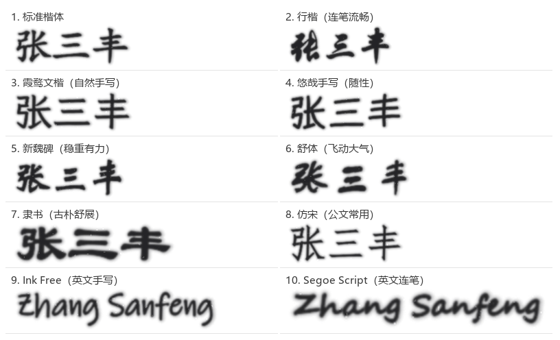

# 手写签名字体生成工具 · Handwritten Signature Tool

[](CHANGELOG.md)
[](README.md)
[](LICENSE)
[](https://www.python.org/)

输入姓名（中文 / 英文），一键生成**透明背景的 PNG 签名图片**，尺寸按毫米精确设定，
直接插入 Word 的合同书、保证书、资料表格签字处。

程序为**免安装单文件 exe**，复制到任意 Windows 10 / Windows 11 电脑即可双击使用，
不写注册表、不依赖 .NET、不需要安装运行库。



---

## 功能一览

| 需求 | 实现 |
| --- | --- |
| 文本输入并识别语言 | 输入框实时识别汉语 / 英语 / 数字 / 符号，显示识别结果；中英混排会自动分段排版，缺字会提示 |
| 无背景 PNG，适配 Word 签字处 | 默认输出 45 × 15 mm、600 DPI 的 RGBA PNG，写入物理尺寸与 DPI 元数据，插入 Word 后**尺寸不变形**；文件通常 60–160 KB |
| 10 种手写字体 | 楷体、行楷、霞鹜文楷、悠哉手写、新魏碑、舒体、隶书、仿宋、Ink Free、Segoe Script；另支持放入自备字体（如毛泽东体） |
| 文字模糊度 | UI 滑块 0–100，0 为锐利，100 为明显晕墨 |
| 文字颜色与类型 | 黑 / 红 / 蓝 × 钢笔 / 圆珠笔 / 铅笔，共 9 种笔迹组合，笔型影响笔锋、颗粒与毛边 |
| 文字粗细度 | UI 滑块，控制笔画加粗 / 变细 |
| 文字颜色深度 | UI 滑块，控制墨色浓淡（淡墨偏灰，浓墨饱满） |
| 字体倾斜度 | UI 滑块，左倾 ← → 右倾（50 为端正），模拟右倾签名的书写习惯 |
| 免安装 exe | PyInstaller onefile，单文件约 30 MB，复制即用 |
| 最大化 / 最小化 | 标准 Windows 窗口，可最大化、最小化、拖动、记忆窗口大小 |
| 操作日志与崩溃日志 | 程序同目录 `logs\`（不可写时自动改用 `%LOCALAPPDATA%\HandwrittenSignatureTool\logs\`），单个文件 2 MB 自动滚动保留 3 份；崩溃单独记录堆栈 |
| 版本控制 | Git 仓库 + 语义化版本 + `CHANGELOG.md`，`build.ps1 -Version x.y.z` 一键升版本 |

---

## 界面上的参数

| 区块 | 参数 | 说明 |
| --- | --- | --- |
| 1. 输入签名文字 | 输入框 | 中英文混排自动分段；下方实时显示「几字 · 汉字几」 |
| 2. 手写字体 | 10 种字体下拉框 | 选中即时预览；「刷新字体列表」「打开字体文件夹」可加载自备 .ttf/.otf |
| 3. 笔型与墨色 | 笔型 × 墨色 | 钢笔 / 圆珠笔 / 铅笔 × 黑 / 红 / 蓝 |
| 4. 字迹微调 | 粗细度 | 细 → 粗 |
| | 模糊度 | 清晰 → 晕染 |
| | 字体倾斜度 | 左倾 → 右倾（50 端正，对应 ±24°） |
| | 颜色深度 | 淡 → 浓 |
| | 笔画抖动 | 工整 → 手写感 |
| | 整体透明度 | 墨色浓淡，100 为完全不透明 |
| 5. 尺寸与清晰度 | 预设 / 毫米 / DPI | 30 × 10、45 × 15、55 × 18 mm 或自定义；300 / 600 / 1200 DPI |
| | 自动裁边 | 开启后图片只保留笔迹，插入 Word 更贴合 |

右侧是「预览（模拟纸张效果）」：按真实毫米比例画出签名在纸张上的大小，
底部状态栏显示像素、毫米、文件大小与耗时。

---

## 快速开始（普通用户）

1. 下载 `HandwrittenSignatureTool-1.0.0-portable.zip` 并解压（或直接使用 `HandwrittenSignatureTool.exe`）。
2. 双击 `HandwrittenSignatureTool.exe`，首次启动约 2–5 秒（onefile 解包到临时目录）。
3. 在左侧输入姓名 → 选择字体与笔迹 → 点「保存 PNG」。
4. Word 中：**插入 → 图片**，选中 PNG，将「环绕方式」设为**浮于文字上方**，
   拖动到签字横线上，再用图片边框调整缩放（因为图片带物理尺寸，默认就是设定的大小）。

> 想要更“像手写”的效果：把「模糊度」调到 20–40，笔型选「钢笔」，颜色深度 75–90。

### 插入 Word 的小技巧

* 签名 PNG 自带 DPI 与物理尺寸，Word 插入时按默认缩放即得到真实大小（默认 45 mm × 15 mm，
  折合 4.5 cm × 1.5 cm，与常见合同签字处高度接近）；工具栏上显示的尺寸也就等于界面里设定的尺寸。
* 需要压住文字或表格线时，环绕方式选「浮于文字上方」；只想贴在签字行内可保持「嵌入型」。
* 透明背景在 Word 页面上一律显示为“无底色”，打印时只有笔迹，不会出现白块。

---

## 字体说明

| # | 字体 | 特点 | 来源 / 授权 |
| --- | --- | --- | --- |
| 1 | 标准楷体 | 规整端正，合同、保证书最常用 | Windows 系统字体，随 exe 打包使用 |
| 2 | 行楷 | 连笔流畅，最有“签名感” | Windows 系统字体 |
| 3 | 霞鹜文楷 | 自然手写，字形圆润 | [LXGW WenKai](https://github.com/lxgw/LxgwWenKai)，SIL OFL 1.1 |
| 4 | 悠哉手写 | 随性洒脱，适合签名 | [Yozai](https://github.com/lxgw/yozai-font)，SIL OFL 1.1 |
| 5 | 新魏碑 | 稳重有力 | Windows 系统字体 |
| 6 | 舒体 | 飞动大气 | Windows 系统字体 |
| 7 | 隶书 | 古朴舒展 | Windows 系统字体 |
| 8 | 仿宋 | 公文常用 | Windows 系统字体 |
| 9 | Ink Free | 英文手写 | Windows 系统字体 |
| 10 | Segoe Script | 英文连笔 | Windows 系统字体 |

* 毛笔字体（如**毛泽东体**、名家手迹体）多受商业授权保护，本工具**不内置、不提供下载**。
  如需使用：菜单「帮助 → 添加自定义字体」会打开字体目录，把自备的 `.ttf / .otf` 放进去：
  程序同目录的 `fonts\`，或 `assets\fonts\custom\`，然后点「刷新字体列表」，
  新字体会出现在下拉框「自备字体」分组里。自定义字体只在本机使用，请遵守字体授权。

---

## 高级用法

### 命令行（批量 / 脚本）

```bat
HandwrittenSignatureTool.exe --list-fonts
HandwrittenSignatureTool.exe --cli "张三" -o sign.png
HandwrittenSignatureTool.exe --cli "Li Si" --font xingkai --pen pencil --color blue ^
    --size 35x14 --dpi 600 --weight 1.15 --depth 0.8 --blur 0.3 -o name.png
HandwrittenSignatureTool.exe --selftest      :: 渲染全部字体做自检（打包后验证用）
HandwrittenSignatureTool.exe --version
```

| 参数 | 说明 |
| --- | --- |
| `--cli` | 不显示窗口，渲染一次后退出 |
| `--font` | 字体 key：`kaiti` `xingkai` `wenkai` `yozai` `xinwei` `shuti` `lisu` `fangsong` `inkfree` `segoescript` |
| `--pen` | `fountain` / `ballpoint` / `pencil` |
| `--color` | `black` / `red` / `blue` |
| `--size` | 毫米尺寸，如 `45x15`、`60x20` |
| `--dpi` | 300 / 600 / 1200 |
| `--weight` `--depth` `--blur` | 0–3 / 0–1 / 0–1 |
| `--seed` | 笔迹随机种子，同一个 seed 得到同一张图 |

### 日志位置

* 操作日志：`logs\hstool.log`（滚动：`hstool.log.1` … `hstool.log.3`）
* 崩溃 / 报错日志：`logs\crash.log`
* 设置与窗口位置：程序同目录 `settings.json`
* 日志目录默认在 exe 旁边；若程序放在只读目录（如 `Program Files`），会自动切换到
  `%LOCALAPPDATA%\HandwrittenSignatureTool\logs\`。
* 菜单「视图 → 打开日志文件夹」可直接定位。

---

## 从源码运行

需要 Windows 10/11、Python 3.9+（推荐 3.11/3.12/3.13）。

```bat
git clone https://github.com/wanwuyijian/Handwritten-font-Tool.git
cd Handwritten-font-Tool

python -m venv .venv
.venv\Scripts\python -m pip install -r requirements.txt
.venv\Scripts\python -m pip install -r requirements-dev.txt

.venv\Scripts\python main.py            :: 启动界面
.venv\Scripts\python tools\run_tests.py :: 运行单元测试（24 项）
.venv\Scripts\python tools\make_samples.py :: 重新生成 docs\styles.png 与示例图
```

> 界面布局是用 tkinter 实现的：左侧两列是可滚动的参数区，右侧是纸张预览。
> 窗口默认 1180 × 760，在 1366 × 768 这类小屏上会自动收缩到工作区内，参数区可滚动。

### 构建免安装 exe

```powershell
powershell -ExecutionPolicy Bypass -File .\build.ps1
# 可选：
#   -Version 1.0.1   改版本号（同步改写 src\hstool\__init__.py）
#   -OneDir          目录版，启动更快，便于排查问题
#   -NoConsole       隐藏控制台窗口
#   -SkipTests       跳过单元测试
```

产物：

* `dist\HandwrittenSignatureTool.exe` —— 单文件免安装程序
* `dist\release\HandwrittenSignatureTool-<版本>-portable.zip` —— 发布包（exe + README + LICENSE）

`build.ps1` 会依次：读取版本 → 用 8 000 常用汉字重新子集化系统字体（约 13 MB）→
跑单元测试 → 生成 PyInstaller spec 与 Windows 版本资源 → 打包 → **用生成的 exe 执行
`--selftest` 验证全部字体可渲染** → 打出发布 zip。

---

## 目录结构

```
Handwritten-font-Tool/
├─ main.py                    入口（PyInstaller 打包目标）
├─ build.ps1                  一键构建脚本
├─ src/hstool/
│  ├─ __init__.py             版本号（唯一来源）
│  ├─ __main__.py             GUI / CLI 入口
│  ├─ gui.py                  tkinter 界面
│  ├─ render.py               签名渲染管线
│  ├─ ink.py                  笔型与墨色
│  ├─ fonts.py                字体目录与解析
│  ├─ text.py                 文本识别（中/英）
│  ├─ options.py              渲染参数
│  ├─ settings.py             设置持久化
│  ├─ logging_setup.py        操作日志 / 崩溃日志
│  └─ paths.py                冻结环境路径处理
├─ assets/
│  ├─ bundle/                 字体子集（woff / zlib）
│  ├─ fonts/                  开源字体全量文件
│  ├─ licenses/               OFL 授权原文
│  ├─ samples/                每种风格的示例签名
│  └─ app.ico                 程序图标
├─ tools/                     构建与测试脚本
└─ docs/                      README 插图
```

---

## 常见问题

**Q：双击没有反应？**
A：打开菜单可用的日志目录（默认 exe 同目录 `logs\`，否则 `%LOCALAPPDATA%\HandwrittenSignatureTool\logs\`），
查看 `crash.log` 与 `hstool.log` 的末尾。也可在命令行运行
`HandwrittenSignatureTool.exe --selftest` 看是否能渲染出全部字体。

**Q：杀毒软件报毒？**
A：PyInstaller 单文件程序被部分启发式引擎误报是常见现象。可先在「病毒和威胁防护 →
排除项」中加入该文件，或使用 `-OneDir` 目录版（误报率更低）。

**Q：插入 Word 后图片太大 / 太小？**
A：图片自带物理尺寸（默认 45 × 15 mm）。Word 中将「缩放比例」设为 100%，或直接改
「大小」里的高度 / 宽度；也可以在「尺寸与清晰度」里换预设或自己填毫米数。

**Q：某些生僻字显示不出来？**
A：字体子集覆盖 8 000 常用汉字 + GB2312。生僻字请选「霞鹜文楷 / 悠哉手写」（覆盖
16 000 字）或放入自备字体；界面会提示缺失的字符。

**Q：可以在 XP / Win7 上运行吗？**
A：不支持，仅面向 Windows 10 / 11（x64）。

---

## 许可

* 本项目代码：MIT License，见 [LICENSE](LICENSE)。
* 内置开源字体：SIL Open Font License 1.1，见 `assets/licenses/`。
* 系统字体（楷体、行楷、新魏、舒体、隶书、仿宋、Ink Free、Segoe Script）
  版权归各字体厂商所有，仅在用户本机打包使用，不随仓库分发；商用前请自行确认授权。

## 更新记录

见 [CHANGELOG.md](CHANGELOG.md)。
